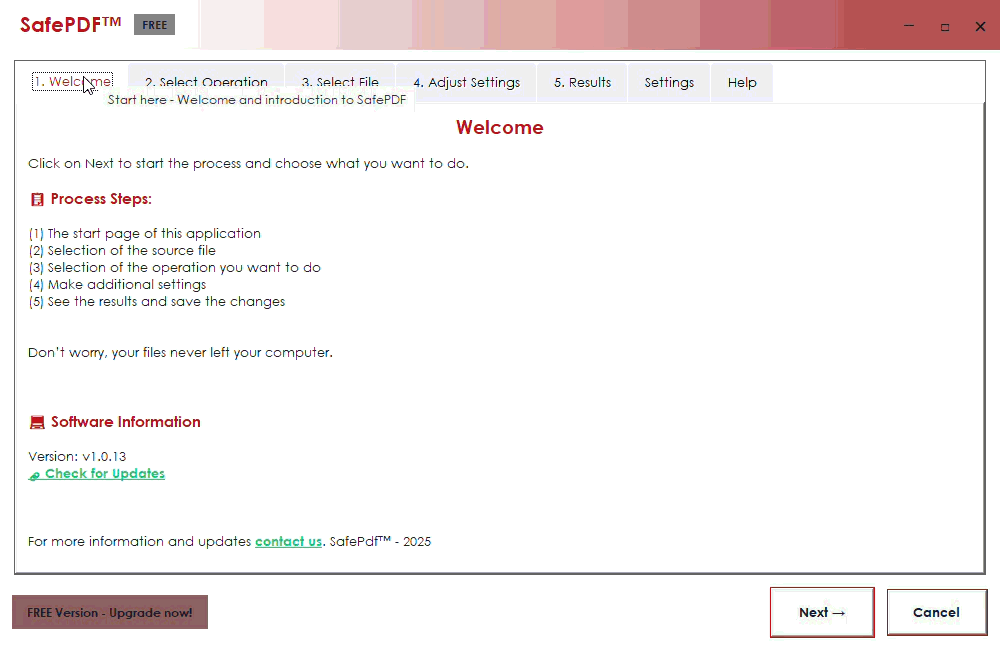

# SafePDF - Privacy-First PDF Toolkit

<p align="center"> 
   
</p>

[](https://github.com/mcagriaksoy/SafePDF/releases/)
[](#license)
[](https://github.com/mcagriaksoy/SafePDF)

**SafePDF** is a free, open-source desktop app for Windows, macOS and Linux. It merges, splits, compresses, converts, rotates and repairs PDFs entirely on your own device — your sensitive documents never leave your computer.

<a href="https://github.com/mcagriaksoy/SafePDF/releases/" download>
  
</a>

## Why SafePDF?

**100% Offline** - No cloud uploads, no internet required  
**Fast & Lightweight** - Operations run directly on your device  
**Privacy First** - Ideal for sensitive documents (legal, healthcare, financial)  
**Multi-language** - English, German, Turkish support

> **Read more:** [The Security Concerns of Online PDF Tools](https://medium.com/dev-genius/the-untold-security-concerns-of-online-pdf-editing-tools-6ee1d83facd6)


## Features

- **Compress** - Reduce PDF file size with quality control
- **Split** - Separate PDFs by pages or custom ranges
- **Merge** - Combine multiple PDF files into one
- **Convert to Images** - Export PDF pages as JPG/JPEG
- **Rotate** - Rotate pages (90°, 180°, 270°)
- **Repair** - Fix corrupted PDF files
- **Convert to Word** - Export PDF as DOCX documents
- **Extract Text** - Extract plain text from PDFs
- **Extract Info** - View PDF metadata and properties

**Interface Features:**
- Drag & drop file selection
- Real-time progress tracking
- Multi-language UI
- Modern, intuitive design




## Quick Start

### Option 1: Download Executable (Recommended)
1. Download the latest release from [Releases](https://github.com/mcagriaksoy/SafePDF/releases/)
2. Extract the ZIP file
3. Run `SafePDF.exe`

### Option 2: Install from PyPI

**Requirements:**
- Python 3.8+
- pip

**Installation:**
```bash
# Install from PyPI
pip install SafePDF

# Optional extras
# OCR support: pip install "SafePDF[ocr]"
# All optional extras: pip install "SafePDF[full]"

# Run the app
safepdf
```

### Option 3: Run from Source

```bash
# Clone the repository
git clone https://github.com/mcagriaksoy/SafePDF.git
cd SafePDF

# Install core dependencies
pip install -r requirements.txt

# Optional extras
# OCR support: pip install ".[ocr]"
# All optional extras: pip install ".[full]"

# Run the application
python run_safe_pdf.py
```

**OCR note:** OCR uses Tesseract. Install the Python extra with `SafePDF[ocr]` and make sure the Tesseract OCR application is installed on your system as well.

## How to Use

1. **Select Operation** - Choose what you want to do (compress, split, merge, etc.)
2. **Select File** - Drag & drop your PDF or click to browse
3. **Adjust Settings** - Configure operation-specific options
4. **Execute** - Click to process your file
5. **View Results** - See output and open the processed file

## Development

### Project Structure
```
SafePDF/
├── SafePDF/
│   ├── ctrl/           # Controllers
│   ├── ui/             # User interface
│   ├── ops/            # PDF operations
│   ├── logger/         # Logging
│   └── text/           # Localization files
├── installer/          # Inno Setup script (Windows installer)
├── scripts/            # CI/release build helpers
├── docs/               # Marketing website (safepdf.de)
├── run_safe_pdf.py     # Main launcher
└── requirements.txt    # Dependencies
```

### Website

The marketing site lives in [`docs/`](docs/) and is published at [safepdf.de](https://safepdf.de). It is plain HTML, CSS and JavaScript with no build step:

```bash
cd docs
python3 -m http.server 8000
# open http://localhost:8000
```

The homepage and the converter pages are also available in German ([`docs/de/`](docs/de/)) and Turkish ([`docs/tr/`](docs/tr/)). Language switching uses real, static URLs so search engines index each language separately — no client-side machine translation.

### Releasing

Releases are driven by version tags. The version in [`SafePDF/__init__.py`](SafePDF/__init__.py) (`__version__`) is the single source of truth and **must match the tag**.

```bash
# 1. Bump __version__ in SafePDF/__init__.py (and SafePDF/version.txt)
# 2. Commit, then create and push a matching tag
git tag v1.2.0
git push origin v1.2.0
```

Pushing a `v*` tag triggers two GitHub Actions workflows:

- **[`release.yml`](.github/workflows/release.yml)** — verifies the tag matches `__version__`, builds the Windows portable executable with PyInstaller, packages the per-user installer with Inno Setup ([`SafePDF/installer/safepdf.iss`](SafePDF/installer/safepdf.iss)), and publishes a GitHub Release with `SafePdf_v<version>_iwin64.exe` and `SafePdf_v<version>_portable_win64.exe`.
- **[`publish-pypi.yml`](.github/workflows/publish-pypi.yml)** — publishes the sdist and wheel to PyPI (Trusted Publishing), which is how Linux and macOS users get SafePDF via `pip install SafePDF`.

Build the Windows artifacts locally with:

```bash
pip install -r requirements.txt pyinstaller
python scripts/build_windows.py           # -> SafePDF/dist/SafePdf_v<version>_portable_win64.exe
# then compile the installer with Inno Setup's ISCC.exe and SafePDF/installer/safepdf.iss
```

The legacy InstallForge flow (`python SafePDF/build_installer.py`) still works for local Windows builds that use InstallForge.

### Contributing

Contributions are welcome! Please:
- Report bugs via [Issues](https://github.com/mcagriaksoy/SafePDF/issues)
- Submit pull requests for improvements
- Follow existing code style

## Support

- **Website:** [safepdf.de](https://safepdf.de) · [Deutsch](https://safepdf.de/de/) · [Türkçe](https://safepdf.de/tr/)
- **Guides:** [Offline PDF tools](https://safepdf.de/offline-pdf-tools.html) · [Secure PDF processing](https://safepdf.de/secure-pdf-processing.html)
- **Email:** [info@safepdf.de](mailto:info@safepdf.de)
- **Bug reports & feature requests:** [GitHub Issues](https://github.com/mcagriaksoy/SafePDF/issues)

## License

Released under [GPL-3.0](/LICENSE) by [@mcagriaksoy](https://github.com/mcagriaksoy).

## Support the Project

<a href="https://www.buymeacoffee.com/mcagriaksoy">
  
</a>

---

Made for privacy-conscious users

